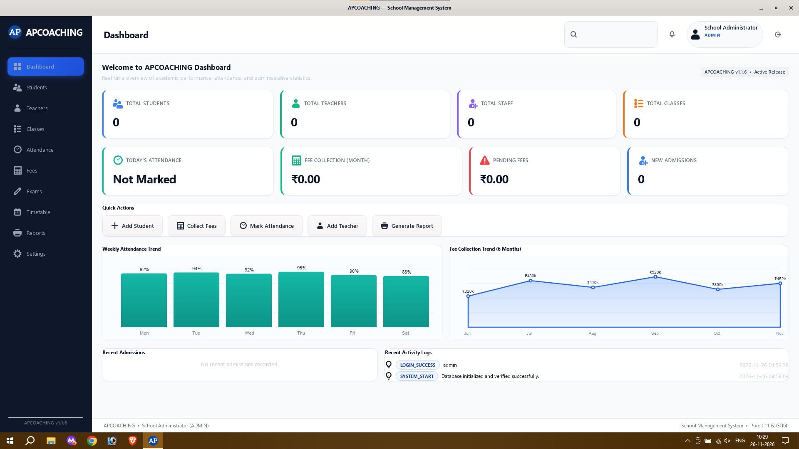
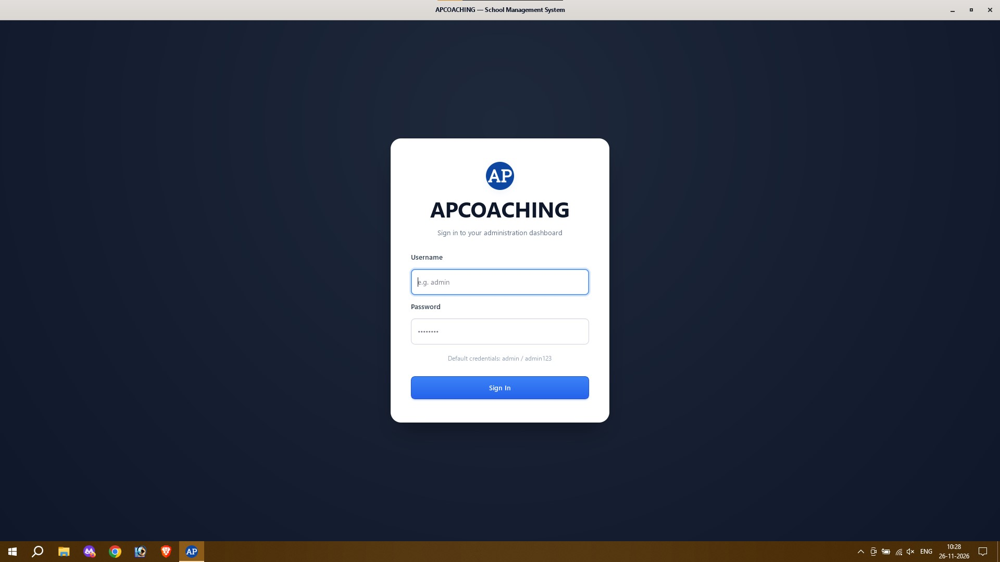
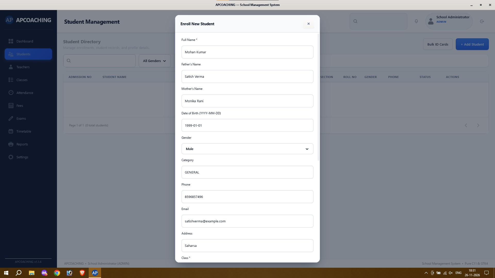

# APCOACHING — Enterprise Desktop School Management System

[](https://en.wikipedia.org/wiki/C11_(C_standard_revision))
[](https://www.gtk.org/)
[](https://www.sqlite.org/)
[](https://microsoft.com/windows)
[](https://cmake.org/)
[-2ea44f.svg)](run_tests.sh)
[](dist/)

A modern, high-performance, offline-first institutional **School Management System** desktop application developed in pure **C (C11)**, **GTK4**, and **SQLite3** for Windows 10 and 11. Designed following enterprise SaaS visual standards, featuring real-time analytics, automated student and faculty rostering, conflict-free timetable scheduling, comprehensive fee accounting, examination grading, RFC 4180 CSV reporting, role-based access control (RBAC), and online SQLite disaster recovery.

<p align="center">
  <a href="#application-preview">Preview Gallery</a> •
  <a href="#documentation-library">Documentation Library</a> •
  <a href="#quick-start-guide">Quick Start</a> •
  <a href="#core-capabilities--features">Core Capabilities</a> •
  <a href="#technology-stack">Tech Stack</a>
</p>

<p align="center">
  
  <br />
  <em>Executive Analytics Dashboard — Real-time KPI cards, Quick Actions bar, Cairo 2D attendance &amp; revenue charts, and live SQLite WAL audit stream</em>
</p>

---

## Documentation Library

To keep the project clean, comprehensive, and easy to navigate, detailed documentation is organized into modular guides:

| Guide | Description |
| :--- | :--- |
| 📖 **[BUILDING.md](docs/BUILDING.md)** | Prerequisites, MSYS2 UCRT64 toolchain setup, CMake & Ninja compilation guide |
| 🧪 **[TESTING.md](docs/TESTING.md)** | Automated test runner, 13 test targets overview (100% pass rate), and test debugging |
| 📦 **[PACKAGING.md](docs/PACKAGING.md)** | Portable zero-dependency release bundle (`.zip`) & Windows Setup Wizard (`.exe`) |
| 🏗️ **[ARCHITECTURE.md](docs/ARCHITECTURE.md)** | Full project directory tree, C11 layered architecture, and 19-table database schema with ER diagram |
| 🎨 **[REBRANDING.md](docs/REBRANDING.md)** | Single-click rebranding via `rebrand.bat`, changing app name, Windows icon, and custom PNG logo |
| 🔧 **[TROUBLESHOOTING.md](docs/TROUBLESHOOTING.md)** | Frequently asked questions, DLL errors, icon rendering fixes, and Excel CSV encoding |
| 📜 **[CHANGELOG.md](docs/CHANGELOG.md)** | Version release notes and complete history of all 34 milestone Git tags |

---

## Quick Start Guide

### 1. Build the Application
Ensure you have the [MSYS2 UCRT64 toolchain installed](docs/BUILDING.md), then run:
```bash
cd C:/apps/SchoolCMS
mkdir -p build && cd build
cmake -G Ninja -DCMAKE_BUILD_TYPE=Release ..
ninja
```

### 2. Run All Tests
```bash
cd C:/apps/SchoolCMS
bash run_tests.sh
```

### 3. Launch the Application
```powershell
.\build\APCOACHING.exe
```

### 4. Create Windows Setup Installer Wizard (.exe)
Double-click `make_installer.bat` or run:
```bash
python scripts/build_installer.py
```
Outputs standalone installer: `dist/APCOACHING-v2.0.0-Setup.exe` (~19.5 MB).

---

## Default Administrator Credentials

On first launch, SQLite automatically runs all schema migrations and creates default admin credentials:

| Field | Value |
| :--- | :--- |
| **Username** | `admin` |
| **Password** | `Password123!` |
| **Role** | `ADMINISTRATOR` |

> [!NOTE]
> All passwords use **PBKDF2-HMAC-SHA256** with 10,000 iterations and a unique salt. The database file `schoolcms.db` is stored locally with Write-Ahead Logging (`WAL`) mode enabled.

---

## Application Preview

Explore every module across the daily institutional workflow — from role-based login to printable report cards, RFC 4180 CSV exports, and disaster recovery.

### 1. Authentication, Students & Faculty

<table>
  <tr>
    <td width="50%" valign="top">
      <strong>Role-Based Login Gate</strong><br />
      <br />
      <sub>PBKDF2-HMAC-SHA256 authentication with per-user salting, account status checks, and 5-attempt brute-force lockout protection.</sub>
    </td>
    <td width="50%" valign="top">
      <strong>Student Directory</strong><br />
      <br />
      <sub>Searchable student roster with gender/status filters, auto-generated admission IDs (<code>ADM-YYYY-XXXX</code>), ID card tools, and confirmation banners.</sub>
    </td>
  </tr>
  <tr>
    <td width="50%" valign="top">
      <strong>In-App Student Registration Modal</strong><br />
      <br />
      <sub>Centered, window-clamped modal overlay form with automatic scrolling, guardian records, and dynamic class/section assignment.</sub>
    </td>
    <td width="50%" valign="top">
      <strong>Teacher &amp; Staff Directory</strong><br />
      <br />
      <sub>Dual-tab personnel hub (<code>Faculty Teachers</code> &amp; <code>Support &amp; Admin Staff</code>) with employee codes, subject allocation, salary, and status filtering.</sub>
    </td>
  </tr>
</table>

### 2. Academic Structure, Attendance & Timetable

<table>
  <tr>
    <td width="50%" valign="top">
      <strong>Classes &amp; Sections</strong><br />
      <br />
      <sub>Organize academic years, grade capacities, nested class sections, and class teacher mappings from one unified view.</sub>
    </td>
    <td width="50%" valign="top">
      <strong>Subjects &amp; Faculty Mapping</strong><br />
      <br />
      <sub>Curriculum registry linking subject codes to target classes and assigned faculty members with inline edit/delete controls.</sub>
    </td>
  </tr>
  <tr>
    <td width="50%" valign="top">
      <strong>Daily &amp; Monthly Attendance</strong><br />
      <br />
      <sub>Class/section daily sheet with one-click <code>Mark All Present</code> / <code>Mark All Absent</code> bulk actions, remarks, monthly registers, and analytics.</sub>
    </td>
    <td width="50%" valign="top">
      <strong>Timetable &amp; Weekly Schedules</strong><br />
      <br />
      <sub>Class timetable and per-faculty weekly schedule views showing period timings, rooms, and conflict-free slot allocation.</sub>
    </td>
  </tr>
</table>

### 3. Fee Accounting & Examinations

<table>
  <tr>
    <td width="50%" valign="top">
      <strong>Fee Collection &amp; Payment Receipts</strong><br />
      <br />
      <sub>Live student due summary, multi-mode payments (Cash, UPI, Bank, Cheque), concession/late-fine entry, and instant receipt printing.</sub>
    </td>
    <td width="50%" valign="top">
      <strong>Fee Structure Configuration</strong><br />
      <br />
      <sub>Create and manage class-wise tuition and recurring fee categories with standardized billing amounts and due dates.</sub>
    </td>
  </tr>
  <tr>
    <td width="50%" valign="top">
      <strong>Examinations &amp; Subject Schedules</strong><br />
      <br />
      <sub>Manage exam windows, subject exam dates, max/pass marks thresholds, batch marks entry, and merit rankings.</sub>
    </td>
    <td width="50%" valign="top">
      <strong>Official Student Report Card</strong><br />
      <br />
      <sub>Printable academic marksheet with subject-wise marks, automatic grades (<code>A+</code> to <code>F</code>), class rank, promotion status, and signatures.</sub>
    </td>
  </tr>
</table>

### 4. Reports Export & System Administration

<table>
  <tr>
    <td width="50%" valign="top">
      <strong>Reports &amp; RFC 4180 CSV Export</strong><br />
      <br />
      <sub>Six filterable report datasets (Students, Attendance, Fee Collections, Pending Dues, Faculty, Exam Results) with UTF-8 BOM Excel-safe CSV export.</sub>
    </td>
    <td width="50%" valign="top">
      <strong>Settings &amp; System Manager</strong><br />
      <br />
      <sub>Seven-tab admin suite: Organization Profile, Security, Email SMTP Gateway, Users &amp; Roles, Role Permissions Matrix, Backup/Restore, and Audit Logs.</sub>
    </td>
  </tr>
</table>

---

## Core Capabilities & Features

- **Modern SaaS UI:** Responsive layout with auto-screen adaptation, dark/light theme, in-window bounded modal overlays, and Cairo 2D charts.
- **Role-Based Access Control (RBAC):** Granular per-module `can_view` / `can_edit` enforcement across sidebar navigation, page routing, dashboard cards, and view actions.
- **Student Lifecycle:** Auto admission codes (`ADM-YYYY-XXXX`), class rostering, profile cards, and bulk ID card printing.
- **Faculty & Staff:** Teacher and non-teaching staff directories with automated payroll records and search.
- **Academic Structure:** Dynamic classes, sections, subjects, and academic years with real-time capacity tracking.
- **Attendance Registers:** Daily classroom marking with one-click bulk toggles and monthly aggregated registers.
- **Institutional Fees:** Fee structures, receipt numbering (`RCP-YYYY-XXXX`), multi-mode payments (Cash, UPI, Bank, Cheque), and dues ledger.
- **Examinations & Grading:** Standard automated grading scale (A+ to F), marks entry sheets, merit ranks, and printable report cards.
- **Timetable Scheduling:** Weekly period matrix with real-time double-booking prevention for teachers and classrooms.
- **Reports & RFC 4180 CSV:** 6 standard institutional reports with UTF-8 BOM encoding for native Microsoft Excel compatibility.
- **Security & Backups:** PBKDF2 authentication, 5-attempt brute-force lockout, Email SMTP gateway, and live hot SQLite online snapshots with one-click restore.

---

## Technology Stack

| Layer | Component | Specification |
| :--- | :--- | :--- |
| **Language** | Core Logic | Pure C (ISO/IEC 9899:2011 - C11) — strictly **no C++** |
| **GUI Framework** | Window & Widgets | GTK4 (`libgtk-4-1.dll`, v4.14+) |
| **Vector Engine** | Charts & 2D Graphics | Cairo (`libcairo-2.dll`) |
| **Font & Text** | Text Layout | Pango (`libpango-1.0-0.dll`) |
| **Database** | Storage Engine | SQLite 3 (`libsqlite3-0.dll`) with WAL mode |
| **Cryptography** | Hashing & Randomness | OpenSSL libcrypto (`libcrypto-4-x64.dll`, PBKDF2-HMAC-SHA256) |
| **Build System** | Metabuild & Compiler | CMake 3.20+ with Ninja & MinGW-w64 GCC (UCRT64) |
| **Packaging** | Bundling & Installer | Python PE Dependency Scanner + NSIS Modern UI 2 |
| **Target OS** | Deployment Platform | Windows 10 / Windows 11 (64-bit x86_64) |

---

## License

Proprietary — All rights reserved. Designed and developed for institutional desktop deployment.
