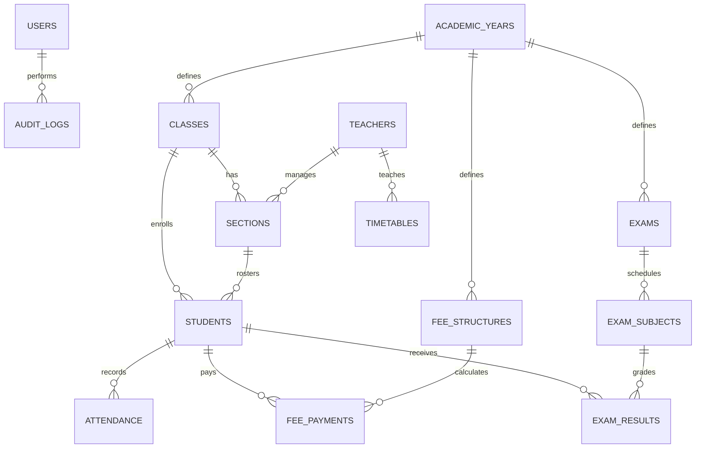

# SchoolCMS — Enterprise Desktop School Management System

[](https://en.wikipedia.org/wiki/C11_(C_standard_revision))
[](https://www.gtk.org/)
[](https://www.sqlite.org/)
[](https://microsoft.com/windows)
[](https://cmake.org/)
[-2ea44f.svg)](file:///c:/apps/SchoolCMS/run_tests.sh)
[](file:///c:/apps/SchoolCMS/dist/)

A modern, high-performance, offline-first institutional **School Management System** desktop application developed in pure **C (C11)**, **GTK4**, and **SQLite3** for Windows 10 and 11. Designed following enterprise SaaS visual standards, featuring real-time analytics, automated student and faculty rostering, conflict-free timetable scheduling, comprehensive fee accounting, examination grading, RFC 4180 CSV reporting, and online SQLite disaster recovery.

---

## Table of Contents

1. [Features & Capabilities](#features--capabilities)
2. [Technology Stack](#technology-stack)
3. [Prerequisites & Environment Setup (MSYS2 UCRT64)](#prerequisites--environment-setup-msys2-ucrt64)
4. [Step-by-Step Compilation & Build Guide](#step-by-step-compilation--build-guide)
5. [Running the Application](#running-the-application)
6. [Step-by-Step Automated Testing](#step-by-step-automated-testing)
7. [Step-by-Step Standalone Release Packaging](#step-by-step-standalone-release-packaging)
8. [Step-by-Step Windows NSIS Installer Creation](#step-by-step-windows-nsis-installer-creation)
9. [Project Architecture & Directory Structure](#project-architecture--directory-structure)
10. [Database Architecture & Schema (19 Tables)](#database-architecture--schema-19-tables)
11. [Troubleshooting & Frequently Asked Questions](#troubleshooting--frequently-asked-questions)
12. [Release Tags & Version History](#release-tags--version-history)
13. [License](#license)

---

## Features & Capabilities

```
+-----------------------------------------------------------------------------------------+
|                                    SchoolCMS Desktop Shell                              |
+-------------------+---------------------------------------------------------------------+
| [Logo] SchoolCMS  |  [ Search... ]           [ Notifications (0) ]   [ Admin (ADMINISTRATOR) ] |
+-------------------+---------------------------------------------------------------------+
| [o] Dashboard     |  +----------------+ +----------------+ +----------------+ +-----------+ |
| [o] Students      |  | Total Students | | Total Teachers | | Total Staff    | | Classes   | |
| [o] Teachers      |  | 248            | | 18             | | 12             | | 8         | |
| [o] Classes       |  +----------------+ +----------------+ +----------------+ +-----------+ |
| [o] Attendance    |                                                                         |
| [o] Fees          |  +---------------------------+  +-------------------------------------+ |
| [o] Exams         |  | Weekly Attendance (Cairo) |  | 6-Month Fee Revenue Trend (Cairo)   | |
| [o] Timetable     |  | [|||||||] Mon-Sat Avg 92% |  | [---/---] Monthly INR Inflow        | |
| [o] Reports       |  +---------------------------+  +-------------------------------------+ |
| [o] Settings      |                                                                         |
|                   |  Quick Actions: [+ Student]  [Collect Fee]  [Mark Attendance]  [Report] |
| v1.0.0            |  Recent Institutional Audit Activity (Live SQLite WAL Stream)           |
+-------------------+---------------------------------------------------------------------+
```

### 1. Modern SaaS Desktop User Interface
- **Sidebar & Stack Navigation:** Persistent left sidebar with 10 primary modules, vector icons, active page indicators, and smooth page transitions via `GtkStack`.
- **Top Header Bar:** Global search field, notification badge, authenticated user display, role badge, and one-click session logout.
- **Visual Design:** SaaS-grade CSS styling with layered card elevation, smooth hover states, rounded pill status badges (`#10B981` active, `#EF4444` inactive, `#F59E0B` pending), and responsive data tables.
- **Cairo Vector Charts:** Custom Cairo 2D drawing areas rendering live weekly attendance bar charts and 6-month fee revenue area charts.

### 2. Student Lifecycle Management
- **Automated Admission Codes:** Format `ADM-YYYY-XXXX` generated inside atomic SQLite transactions.
- **Rostering & Filtering:** Instant filter by Class, Section, and Enrollment Status (`ACTIVE`, `INACTIVE`, `SUSPENDED`).
- **Pagination & CRUD Dialogs:** 15 records per page with next/previous controls, Add Student modal, Edit Student modal, and deletion with confirmation.
- **Student Profile Modal:** View full contact details, emergency phone, address, blood group, and class assignment.

### 3. Faculty & Staff Management
- **Teacher Directory:** Automatic `TCH-YYYY-XXXX` code generator, subject specialization, joining date, monthly salary, and status.
- **Non-Teaching Staff Directory:** Automatic `STF-YYYY-XXXX` code generator, administrative role titles (Accountant, Librarian, Lab Assistant, Clerk), and contact information.
- **Dual-Tab Interface:** Seamless tab switching between Teachers and Staff with real-time text search.

### 4. Academic Structure (Classes & Sections)
- **Class Directory:** Numeric values (1–12), custom class names, and capacity limits.
- **Section Allocation:** Dynamic section assignment (`A`, `B`, `C`, `D`) with class teacher mapping.
- **Capacity Enforcement:** Real-time student count tracking preventing class over-allocation.

### 5. Attendance Registers
- **Daily Attendance Marking:** Class and section roster with one-click toggles: `PRESENT`, `ABSENT`, `LATE`, `HALF_DAY`, and `EXCUSED`.
- **Bulk Transactions:** Save entire classroom attendance in a single atomic SQLite transaction.
- **Monthly Summary Register:** Aggregated percentage statistics per student with quick identification of chronically absent students (<75%).

### 6. Institutional Fee Management
- **Fee Structures:** Configurable tuition, examination, computer, library, and sports fees mapped by class and academic year.
- **Receipt Generator:** Unique receipt numbering `RCP-YYYY-XXXX` with multi-mode payment recording (`CASH`, `UPI`, `BANK_TRANSFER`, `CHEQUE`).
- **Dues Ledger:** Real-time balance calculations showing total fees billed, total paid, and pending balances.
- **Printable Receipt Dialog:** Formatted institutional receipt modal ready for printing or digital archiving.

### 7. Examination, Marks Entry & Results
- **Exam Scheduling:** Define Term, Mid-Term, and Annual exams linked to academic years.
- **Subject Schedules:** Max marks and passing marks per subject.
- **Marks Entry Sheet:** Direct classroom grade entry with automatic score calculation.
- **Automated Grading Scale:**
  - `90% - 100%`: **A+** (4.00 GPA) — Outstanding
  - `80% - 89%`: **A** (3.75 GPA) — Excellent
  - `70% - 79%`: **B** (3.00 GPA) — Very Good
  - `60% - 69%`: **C** (2.00 GPA) — Good
  - `50% - 59%`: **D** (1.00 GPA) — Pass
  - `< 50%`: **F** (0.00 GPA) — Fail
- **Report Card Modal & Merit Board:** Printable individual student marksheet and class rank calculation.

### 8. Timetable Scheduling & Conflict Prevention
- **Weekly Schedule Grid:** Monday through Saturday visual grid across 8 class periods.
- **Double-Booking Engine:** Real-time collision detection preventing:
  - Teacher double-booking (same teacher assigned to two classes simultaneously).
  - Room double-booking (two classes assigned to the same room simultaneously).
- **Faculty View:** Filter schedule by individual teacher to view their weekly teaching load.

### 9. Institutional Reports & RFC 4180 CSV Data Export
- **6 Standard Reports:**
  1. *Student Directory* (Roll, Admission No, Name, Gender, Class, Phone, Status)
  2. *Fee Collection & Dues Ledger* (Student, Billed, Paid, Dues, Payment Date)
  3. *Daily Attendance Register* (Class, Date, Present/Absent Counts, Percentages)
  4. *Exam Result & Merit List* (Exam, Student, Marks Obtained, Total, Percentage, Grade, Rank)
  5. *Faculty & Staff Directory* (Code, Name, Department/Role, Phone, Salary, Status)
  6. *Class Roster & Capacity Sheet* (Class, Section, Teacher, Current Enrolled, Max Capacity)
- **RFC 4180 CSV Engine:** Export clean CSV files with quotes, comma escaping, and UTF-8 BOM (`\xEF\xBB\xBF`) for native Microsoft Excel compatibility.

### 10. System Settings, Security & Disaster Recovery
- **School Profile:** Edit institution name, tagline, address, phone, email, affiliation board, and current academic year.
- **Appearance:** Light / Dark theme toggle saved to database settings.
- **PBKDF2-HMAC-SHA256 Cryptography:** Passwords hashed with 10,000 iterations and unique 16-byte random cryptographic salts.
- **Brute-Force Lockout:** Account locks automatically after 5 consecutive failed attempts.
- **Online Hot SQLite Backup:** Creates consistent live database snapshots (`db_backup`) using the SQLite Online Backup API without downtime or table locking.
- **Atomic Database Restore:** Atomically replaces active database with a chosen snapshot and triggers WAL checkpoint.
- **Audit Logging:** Every administrative action (login, student create, fee payment, backup) is recorded in the `audit_logs` table.

---

## Technology Stack

| Layer | Component | Specification |
| :--- | :--- | :--- |
| **Language** | Core Logic | Pure C (ISO/IEC 9899:2011 - C11) — strictly **no C++** |
| **GUI Framework** | Window & Widgets | GTK4 (`libgtk-4-1.dll`, v4.14+) |
| **Vector Engine** | Charts & 2D Graphics | Cairo (`libcairo-2.dll`, `libcairo-gobject-2.dll`) |
| **Font & Text** | Text Layout | Pango (`libpango-1.0-0.dll`, `libpangocairo-1.0-0.dll`) |
| **Image & Icon** | Icon Themes & Pixbufs | GDK-Pixbuf + librsvg (`librsvg-2-2.dll`, `pixbufloader_svg.dll`) |
| **Database** | Storage Engine | SQLite 3 (`libsqlite3-0.dll`, v3.45+) with WAL mode |
| **Cryptography** | Hashing & Randomness | OpenSSL libcrypto (`libcrypto-4-x64.dll`, PBKDF2-HMAC-SHA256) |
| **Styling** | Visual Theme | GTK CSS Provider with Adwaita vector symbolic icons |
| **Build System** | Metabuild & Compiler | CMake 3.20+ with Ninja & MinGW-w64 GCC (UCRT64) |
| **Packaging** | Bundling & Installer | Python PE Dependency Scanner + NSIS (Nullsoft Installer) |
| **Target OS** | Deployment Platform | Windows 10 / Windows 11 (64-bit x86_64) |

---

## Prerequisites & Environment Setup (MSYS2 UCRT64)

SchoolCMS is built natively on Windows using the **MSYS2 UCRT64** toolchain.

### Step 1: Install MSYS2
1. Download the MSYS2 installer from [https://www.msys2.org/](https://www.msys2.org/).
2. Run the installer and install to `C:\msys64` (default).
3. Once installation completes, open the **MSYS2 UCRT64** terminal:
   - Shortcut: `MSYS2 UCRT64` from Start Menu, OR
   - Run `C:\msys64\ucrt64.exe`.

### Step 2: Install Compiler, GTK4, SQLite, and Tooling
Execute the following commands inside the MSYS2 UCRT64 terminal:

```bash
# Update package databases
pacman -Syu --noconfirm

# Install C11 compiler, CMake, Ninja, and build tools
pacman -S --needed --noconfirm \
    mingw-w64-ucrt-x86_64-gcc \
    mingw-w64-ucrt-x86_64-cmake \
    mingw-w64-ucrt-x86_64-ninja \
    mingw-w64-ucrt-x86_64-pkg-config \
    mingw-w64-ucrt-x86_64-gdb \
    git

# Install GTK4, SQLite3, OpenSSL, SVG renderer, and icon themes
pacman -S --needed --noconfirm \
    mingw-w64-ucrt-x86_64-gtk4 \
    mingw-w64-ucrt-x86_64-sqlite3 \
    mingw-w64-ucrt-x86_64-openssl \
    mingw-w64-ucrt-x86_64-librsvg \
    mingw-w64-ucrt-x86_64-gdk-pixbuf2 \
    mingw-w64-ucrt-x86_64-adwaita-icon-theme \
    mingw-w64-ucrt-x86_64-hicolor-icon-theme

# Install Python (required for release packaging script)
pacman -S --needed --noconfirm mingw-w64-ucrt-x86_64-python
```

### Step 3: Configure Windows System PATH (Optional for CMD / PowerShell)
To run build commands directly from Windows PowerShell or Command Prompt, add the following directories to your Windows `PATH`:
- `C:\msys64\ucrt64\bin`
- `C:\msys64\usr\bin`

You can verify the setup by opening PowerShell and running:
```powershell
gcc --version
cmake --version
ninja --version
pkg-config --modversion gtk4
```

---

## Step-by-Step Compilation & Build Guide

### Option A: Building with CMake and Ninja (Recommended — Fastest)

1. Open your terminal (MSYS2 UCRT64 or PowerShell with UCRT64 in PATH):
   ```bash
   cd C:/apps/SchoolCMS
   ```

2. Create a clean build directory:
   ```bash
   mkdir -p build
   cd build
   ```

3. Run CMake configuration targeting the Ninja generator:
   ```bash
   cmake -G Ninja -DCMAKE_BUILD_TYPE=Release ..
   ```

4. Compile the application and all test suites:
   ```bash
   ninja
   ```

   **Compilation Output:**
   - `build/SchoolCMS.exe` (main application binary)
   - `build/assets/` (copied application assets and styles)
   - 13 test binaries (`test_database.exe`, `test_auth.exe`, etc.)

### Option B: Building with CMake and MinGW Makefiles

If you do not have Ninja installed:
```bash
cd C:/apps/SchoolCMS
mkdir -p build && cd build
cmake -G "MinGW Makefiles" -DCMAKE_BUILD_TYPE=Release ..
cmake --build . -j4
```

---

## Running the Application

### Launching in Development Mode
From the `build/` directory:
```bash
./SchoolCMS.exe
```

Or from the project root in PowerShell:
```powershell
.\build\SchoolCMS.exe
```

### Default Administrator Credentials
On first launch, SQLite automatically runs all migrations, creates the 19-table schema, and seeds default administrative credentials:

| Field | Value |
| :--- | :--- |
| **Username** | `admin` |
| **Password** | `Password123!` |
| **Role** | `ADMINISTRATOR` |

> [!NOTE]
> All passwords are cryptographically hashed using **PBKDF2-HMAC-SHA256** with 10,000 iterations and a unique salt. The database file `schoolcms.db` is stored locally in the application working directory with Write-Ahead Logging (`WAL`) mode enabled.

---

## Step-by-Step Automated Testing

SchoolCMS includes 13 comprehensive unit and integration test executables verifying every backend service, database migration, grade computation, timetable collision check, and export routine.

### Running All Tests via the Test Runner Script
From the project root:

```bash
# In MSYS2 UCRT64 or Git Bash:
bash run_tests.sh
```

Or in PowerShell:
```powershell
& "C:\msys64\usr\bin\bash.exe" -c 'export PATH="/c/msys64/ucrt64/bin:/usr/bin:$PATH" && cd /c/apps/SchoolCMS && ./run_tests.sh'
```

### Test Suite Execution Summary (100% Pass Rate)

| Test Executable | Target Module | Scope of Verification | Status |
| :--- | :--- | :--- | :--- |
| `test_database.exe` | Database Core | 19 tables, indexes, WAL journal mode, seed data, online backup handle | **PASS** |
| `test_auth.exe` | Authentication | PBKDF2 hashing, salt generation, 5-attempt lockout, sessions | **PASS** |
| `test_dashboard.exe` | Dashboard | Real-time SQL metric aggregations, attendance rates, fee sums | **PASS** |
| `test_student.exe` | Students | Student CRUD, `ADM-YYYY-XXXX` generator, filtering, pagination | **PASS** |
| `test_teacher.exe` | Faculty & Staff | `TCH-` & `STF-` code generation, department filters, staff CRUD | **PASS** |
| `test_classes.exe` | Classes & Sections | Class creation, section limits, capacity overflow prevention | **PASS** |
| `test_attendance.exe` | Attendance | Daily roster marking, bulk transactions, monthly percentages | **PASS** |
| `test_fees.exe` | Fee Management | Fee structures, duplicate payment guard, receipts, dues ledger | **PASS** |
| `test_exams.exe` | Examinations | Exam schedules, marks entry, automatic grading (A+..F), ranks | **PASS** |
| `test_timetable.exe` | Timetables | Schedule slots, teacher collision prevention, room conflict check | **PASS** |
| `test_reports.exe` | Reporting | 6 report generators, RFC 4180 CSV escaping, UTF-8 BOM headers | **PASS** |
| `test_settings.exe` | System Settings | School profile mutations, online snapshot backup & restore | **PASS** |
| `test_system_integration.exe` | End-to-End | 8 multi-module workflows connecting students, fees, exams, timetable | **PASS** |

---

## Step-by-Step Standalone Release Packaging

Because Windows does not include GTK4, SQLite, or GDK-Pixbuf loaders natively, SchoolCMS includes an automated release packager that gathers `SchoolCMS.exe`, scans all imported PE headers, and bundles all 65 transitive runtime DLLs, compiled icon themes, and schemas into a zero-dependency portable package.

### Step 1: Ensure Executable is Built
Make sure you have compiled the latest executable:
```bash
cd C:/apps/SchoolCMS/build && ninja
```

### Step 2: Run the Packaging Script
You can package using Python, Bash, or Windows Batch:

**Using Python (Direct):**
```bash
python scripts/package_windows.py
```

**Using Bash:**
```bash
bash scripts/package_windows.sh
```

**Using Windows Batch:**
```cmd
scripts\package_windows.bat
```

### Step 3: Packaged Distribution Output
The packaging pipeline generates two release artifacts in `dist/`:

1. **Portable Directory:** `dist/SchoolCMS-v1.0.0-windows-x64/`
   ```
   dist/SchoolCMS-v1.0.0-windows-x64/
   ├── SchoolCMS.exe                 # Main compiled C11 application binary
   ├── Run_SchoolCMS.bat             # Production launcher script with environment setup
   ├── README.txt                    # Standalone end-user instructions
   ├── 65 Runtime DLLs               # libgtk-4-1, librsvg-2-2, libsqlite3, libcrypto, etc.
   ├── assets/
   │   └── styles/main.css           # Modern SaaS stylesheet
   ├── lib/
   │   └── gdk-pixbuf-2.0/2.10.0/
   │       ├── loaders/              # pixbufloader_svg.dll and image decoders
   │       └── loaders.cache         # Registered image loader cache
   └── share/
       ├── glib-2.0/schemas/         # gschemas.compiled settings definitions
       └── icons/
           ├── Adwaita/              # Full vector Adwaita symbolic SVGs & cache
           └── hicolor/              # Fallback theme definitions
   ```

2. **Compressed Release Archive:** `dist/SchoolCMS-v1.0.0-windows-x64.zip` (~27.7 MB)
   - Self-contained, portable, zero-dependency ZIP archive ready for distribution to end users.
   - Users simply extract the ZIP on any Windows 10/11 x64 PC and double-click `Run_SchoolCMS.bat`.

---

## Step-by-Step Windows NSIS Installer Creation

To create a professional Windows setup installer (`SchoolCMS-v1.0.0-Setup.exe`) with desktop shortcuts, Start Menu integration, and a clean uninstaller:

### Step 1: Install NSIS
Install NSIS using MSYS2 or download from [https://nsis.sourceforge.io/](https://nsis.sourceforge.io/):
```bash
pacman -S --needed --noconfirm mingw-w64-ucrt-x86_64-nsis
```

### Step 2: Compile the Installer Script
Run the NSIS compiler targeting [scripts/installer.nsi](file:///c:/apps/SchoolCMS/scripts/installer.nsi):
```bash
makensis scripts/installer.nsi
```

### Step 3: Installer Output
- **Target File:** `dist/SchoolCMS-v1.0.0-Setup.exe`
- **Features:**
  - Installs to `C:\Program Files\SchoolCMS`
  - Creates Desktop shortcut and Start Menu program group
  - Registers clean uninstaller in Windows *Settings > Installed apps*

---

## Project Architecture & Directory Structure

```
SchoolCMS/
├── CMakeLists.txt              # Top-level CMake build definition with all targets
├── README.md                   # Complete documentation and developer guide
├── roadmap.md                  # 15-phase technical specification checklist
├── run_tests.sh                # Automated test runner script for 13 suites
├── assets/                     # Application visual resources
│   └── styles/
│       └── main.css            # Custom GTK4 CSS styling rules
├── include/                    # Public C header interfaces
│   ├── app.h                   # Application lifecycle & environment prototypes
│   ├── database.h              # SQLite connection, migration & backup prototypes
│   ├── auth/auth.h             # PBKDF2 hashing & session prototypes
│   ├── dashboard.h             # Live KPI aggregations & Cairo chart queries
│   ├── student.h               # Student models & CRUD prototypes
│   ├── teacher.h               # Teacher and staff models & CRUD prototypes
│   ├── classes.h               # Class & section management prototypes
│   ├── attendance.h            # Attendance marking & monthly register prototypes
│   ├── fees.h                  # Fee structures, receipt generator & dues prototypes
│   ├── exams.h                 # Exam schedules, auto-grading & marksheet prototypes
│   ├── timetable.h             # Timetable grid & collision detection prototypes
│   ├── reports.h               # 6-category report generator & CSV export prototypes
│   ├── settings.h              # Institutional profile, theme & restore prototypes
│   └── ui/                     # GTK4 view widget interfaces
│       ├── window.h            # Main window & stack navigation
│       ├── header.h            # Top header bar
│       ├── sidebar.h           # Sidebar navigation panel
│       ├── login.h             # Authentication login screen
│       ├── dashboard.h         # Dashboard widgets & Cairo visualizers
│       ├── student_view.h      # Student directory & modal forms
│       ├── teacher_view.h      # Teacher/staff directory & modal forms
│       ├── classes_view.h      # Classes & sections view
│       ├── attendance_view.h   # Daily & monthly attendance view
│       ├── fee_view.h          # Fee collection, receipts & dues view
│       ├── exam_view.h         # Exams, marks sheet & report card view
│       ├── timetable_view.h    # Timetable weekly grid & slot modals
│       ├── reports_view.h      # Reports selector, table preview & export
│       └── settings_view.h     # Profile editor, theme toggle & backup/restore
├── src/                        # C11 Implementation source files
│   ├── main.c                  # Application entry point (main)
│   ├── app.c                   # GtkApplication, CSS loading & environment setup
│   ├── database.c              # SQLite migration engine & backup routines
│   ├── auth/auth.c             # PBKDF2 cryptography & lockout protection
│   ├── dashboard.c             # Live SQL metric queries & calculations
│   ├── student.c               # Student SQLite database operations
│   ├── teacher.c               # Teacher/staff operations & code generation
│   ├── classes.c               # Class & section database operations
│   ├── attendance.c            # Daily marking & monthly statistics
│   ├── fees.c                  # Fee payments, receipt generator & dues
│   ├── exams.c                 # Exam schedules, marks grading & ranks
│   ├── timetable.c             # Timetable query & double-booking engine
│   ├── reports.c               # Report dataset compiler & RFC 4180 CSV
│   ├── settings.c              # Settings persistence & atomic snapshot restore
│   └── ui/                     # GTK4 UI widget implementations
│       ├── window.c            # Application window & root view switcher
│       ├── header.c            # Header bar with user profile & logout
│       ├── sidebar.c           # Left navigation panel with symbolic icons
│       ├── login.c             # Login view with validation & feedback banners
│       ├── dashboard.c         # Dashboard widgets & Cairo drawing handlers
│       ├── student_view.c      # Paginated student table & CRUD modals
│       ├── teacher_view.c      # Dual-tab faculty directory & profile modals
│       ├── classes_view.c      # Classes & sections management
│       ├── attendance_view.c   # Attendance register & bulk save
│       ├── fee_view.c          # Fee collection & printable receipt modal
│       ├── exam_view.c         # Marks entry sheet & marksheet preview modal
│       ├── timetable_view.c    # Timetable weekly grid & conflict modal
│       ├── reports_view.c      # Reports view, table preview & CSV save dialog
│       └── settings_view.c     # Profile form, theme switch & backup dialogs
├── tests/                      # Unit and integration test suites
│   ├── test_database.c
│   ├── test_auth.c
│   ├── test_dashboard.c
│   ├── test_student.c
│   ├── test_teacher.c
│   ├── test_classes.c
│   ├── test_attendance.c
│   ├── test_fees.c
│   ├── test_exams.c
│   ├── test_timetable.c
│   ├── test_reports.c
│   ├── test_settings.c
│   └── test_system_integration.c
└── scripts/                    # Packaging and distribution tools
    ├── package_windows.py      # Automated PE DLL scanner & portable packager
    ├── package_windows.sh      # Shell wrapper for release packaging
    ├── package_windows.bat     # Windows Batch wrapper for packaging
    └── installer.nsi           # NSIS installer definition script
```

---

## Database Architecture & Schema (19 Tables)

SchoolCMS uses SQLite 3 with Foreign Key constraints enabled and Write-Ahead Logging (`PRAGMA journal_mode=WAL;`) for concurrent read/write throughput without blocking.



### Table Index
1. `schema_migrations`: Version tracking for database schema updates.
2. `settings`: Institutional profile key-value storage (school name, phone, theme, etc.).
3. `academic_years`: School sessions (e.g., `2026-2027`, start date, end date, active flag).
4. `users`: System login accounts with PBKDF2 hash, salt, role, and lockout counters.
5. `teachers`: Teaching faculty records (`TCH-YYYY-XXXX`), salary, joining date, status.
6. `staff`: Non-teaching staff (`STF-YYYY-XXXX`), role title, salary, phone, status.
7. `classes`: Academic classes (1–12), numeric order, capacity limits.
8. `sections`: Sub-divisions (`A`, `B`, `C`), class teacher foreign key.
9. `students`: Student master record (`ADM-YYYY-XXXX`), demographics, parent contact, status.
10. `attendance`: Daily records per student (`PRESENT`, `ABSENT`, `LATE`, `HALF_DAY`, `EXCUSED`).
11. `fee_structures`: Fee types, due dates, amount per class and academic year.
12. `fee_payments`: Receipts (`RCP-YYYY-XXXX`), amounts, payment modes (`CASH`, `UPI`, `BANK_TRANSFER`, `CHEQUE`).
13. `exams`: Institutional examinations (Term 1, Midterm, Final) and dates.
14. `exam_subjects`: Subject schedule, max marks, passing marks, exam date/time.
15. `exam_results`: Student marks obtained, computed percentage, grade (`A+`..`F`), and GPA.
16. `subjects`: Master list of taught subjects (Mathematics, English, Physics, etc.).
17. `timetables`: Weekly schedule grid records (day, period, class, section, teacher, room).
18. `audit_logs`: Administrative event log (timestamp, user, action, module, details).
19. `notifications`: System announcements, fee due alerts, and schedule changes.

---

## Troubleshooting & Frequently Asked Questions

### 1. Missing DLL Errors on Standalone Execution
- **Symptom:** Running `SchoolCMS.exe` on a fresh Windows PC shows `The code execution cannot proceed because libgtk-4-1.dll was not found`.
- **Solution:** Always run the application via `Run_SchoolCMS.bat` or ensure all 65 bundled DLLs from `dist/SchoolCMS-v1.0.0-windows-x64/` are in the same directory as `SchoolCMS.exe`.

### 2. Broken or Missing Vector Icons
- **Symptom:** UI displays blank boxes instead of icons in the sidebar, header, or dashboard.
- **Root Cause:** GTK4 symbolic icons are SVG files loaded via `pixbufloader_svg.dll`. If `librsvg-2-2.dll` or `loaders.cache` is missing, SVG loading fails.
- **Solution:** Re-run `python scripts/package_windows.py`. The packager explicitly includes `librsvg-2-2.dll` and bundles `share/icons/Adwaita` with a compiled `icon-theme.cache`.

### 3. GLib GSettings Schema Not Found
- **Symptom:** Application exits on startup with `GLib-GIO-ERROR **: Settings schema 'org.gtk.gtk4.Settings.FileChooser' is not installed`.
- **Solution:** Set `GSETTINGS_SCHEMA_DIR` to the directory containing `gschemas.compiled`. When running via `Run_SchoolCMS.bat`, this is set automatically.

### 4. Database Locked (`SQLITE_BUSY`)
- **Symptom:** Database transactions fail with `database is locked`.
- **Solution:** Ensure only one instance of `SchoolCMS.exe` is running. SQLite WAL mode supports multiple concurrent readers and one writer, but separate processes attempting concurrent schema mutations can cause busy locks. Kill any background zombie processes with `taskkill /F /IM SchoolCMS.exe`.

### 5. CSV Displaying Garbled Characters in Microsoft Excel
- **Symptom:** Exported CSV files show character encoding issues for symbols or non-ASCII characters in Excel.
- **Solution:** SchoolCMS automatically prefixes all generated CSV files with the UTF-8 Byte Order Mark (`\xEF\xBB\xBF`), ensuring Microsoft Excel natively parses UTF-8 encoding without manual import wizard configuration.

---

## Release Tags & Version History

This repository maintains 32 annotated Git tags tracking each milestone from initial shell to production release:

| Tag Name | Target Commit | Milestone Description |
| :--- | :--- | :--- |
| `phase-01-app-shell` | `a8b1e29` | Phase 1: GTK4 shell, main window, sidebar, and dashboard widgets |
| `v0.1.0` | `a8b1e29` | SchoolCMS v0.1.0 - Application Shell & Navigation |
| `phase-02-database` | `6c15a45` | Phase 2: Database migration system (19 tables, indexes, WAL mode) |
| `v0.2.0` | `6c15a45` | SchoolCMS v0.2.0 - SQLite3 Migrations & Schema |
| `phase-03-auth-login` | `071b5a2` | Phase 3: Login view, PBKDF2 hashing, lockout protection |
| `v0.3.0` | `071b5a2` | SchoolCMS v0.3.0 - Authentication & Session Lockout |
| `phase-04-dashboard-charts`| `143bd7b` | Phase 4: Main dashboard with live SQL aggregations & Cairo charts |
| `v0.4.0` | `143bd7b` | SchoolCMS v0.4.0 - Live Dashboard & Cairo Charting |
| `phase-05-students-crud` | `eca730a` | Phase 5: Student CRUD, `ADM-` code generator, pagination |
| `v0.5.0` | `eca730a` | SchoolCMS v0.5.0 - Student Lifecycle Management |
| `phase-06-teachers-staff` | `2de2b12` | Phase 6: Faculty directory, `TCH-`/`STF-` code generation |
| `v0.6.0` | `2de2b12` | SchoolCMS v0.6.0 - Faculty & Staff Management |
| `phase-07-classes-sections`| `c9abcef` | Phase 7: Class & section management with capacity limits |
| `v0.7.0` | `c9abcef` | SchoolCMS v0.7.0 - Academic Structure & Rostering |
| `phase-08-attendance-system`| `b654cfe` | Phase 8: Daily marking, bulk transactions, monthly registers |
| `v0.8.0` | `b654cfe` | SchoolCMS v0.8.0 - Attendance Marking & Registers |
| `phase-09-fee-management` | `fa1d9f4` | Phase 9: Fee structures, payments, receipts, dues ledger |
| `v0.9.0` | `fa1d9f4` | SchoolCMS v0.9.0 - Institutional Fee Accounting |
| `phase-10-exams-grading` | `fc89b7e` | Phase 10: Exam schedules, marks entry, auto-grading, merit ranks |
| `v0.10.0` | `fc89b7e` | SchoolCMS v0.10.0 - Examinations & Results Processing |
| `phase-11-timetable-grid` | `d71550e` | Phase 11: Weekly timetable grid & collision detection engine |
| `v0.11.0` | `d71550e` | SchoolCMS v0.11.0 - Timetable Scheduling & Conflict Prevention |
| `phase-12-reports-csv-export`| `46bb86a`| Phase 12: 6 institutional reports & RFC 4180 CSV export |
| `v0.12.0` | `46bb86a` | SchoolCMS v0.12.0 - Reporting & Data Export Engine |
| `phase-13-settings-backup` | `a438ba8` | Phase 13: School profile, theme switch, online SQLite backup |
| `v0.13.0` | `a438ba8` | SchoolCMS v0.13.0 - Settings, Theme & Disaster Recovery |
| `phase-14-verification-tests`| `82d8297`| Phase 14: 13 test suites, integration tests, 100% pass rate |
| `v0.14.0` | `82d8297` | SchoolCMS v0.14.0 - Comprehensive Verification & 100% Test Coverage |
| `phase-15-windows-packaging`| `1ccb083` | Phase 15: Windows standalone EXE packaging & NSIS installer |
| `v1.0.0-rc1` | `1ccb083` | SchoolCMS v1.0.0-rc1 - Release Candidate with Portable Packaging |
| `v1.0.0-ui-overhaul` | `63842d0` | Modern enterprise SaaS UI/UX overhaul & styling |
| `v1.0.0` | `d63ee38` | Production release with full vector icon fix & 65 runtime DLLs |
| `v1.0.1` | `b808c96` | Comprehensive installation, compilation & packaging documentation |
| `v1.1.0` | `5936e61` | Database Backup Inventory, Dynamic Dropdowns, Student ID Cards & Responsive Auto-Resize |

---

## License

Proprietary — All rights reserved. Designed and developed for institutional desktop deployment.
