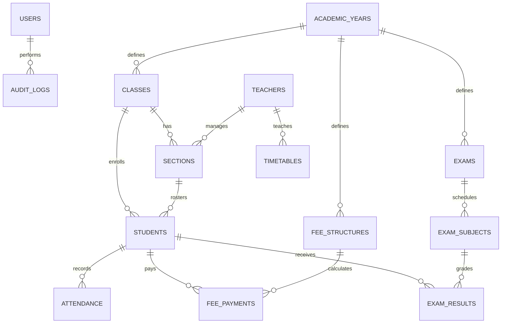

# System Architecture & Database Schema — SchoolCMS

SchoolCMS is engineered with a strict layered architecture: pure C11 business logic modules, GTK4 UI view components, and an offline-first SQLite3 persistence layer with Write-Ahead Logging (`WAL`).

---

## 1. Directory Structure & Code Organization

```
SchoolCMS/
├── CMakeLists.txt              # Top-level CMake build definition with all targets
├── README.md                   # Main documentation portal & quick-start
├── make_installer.bat          # Single-click Windows Setup.exe builder
├── run_tests.sh                # Automated test runner script for all 13 suites
├── assets/                     # Visual assets, styles, and logos
│   ├── icons/                  # Windows app.ico and icon assets
│   ├── images/                 # App logo and institutional images
│   └── styles/main.css         # Modern SaaS CSS styling rules
├── docs/                       # Modular documentation guides
│   ├── BUILDING.md             # Compilation & MSYS2 setup guide
│   ├── TESTING.md              # Test execution & verification summary
│   ├── PACKAGING.md            # Standalone bundling & installer wizard
│   ├── ARCHITECTURE.md         # Directory structure & 19-table schema
│   ├── REBRANDING.md           # Rebranding, icons & naming customization
│   ├── TROUBLESHOOTING.md      # FAQs and runtime troubleshooting
│   └── CHANGELOG.md            # Release tags & version history
├── include/                    # Public C11 header interfaces
│   ├── app.h                   # Application lifecycle & environment prototypes
│   ├── database.h              # SQLite connection, migration & backup prototypes
│   ├── auth/auth.h             # PBKDF2 hashing & session prototypes
│   ├── dashboard.h             # Live KPI aggregations & Cairo chart queries
│   ├── student.h               # Student models & CRUD prototypes
│   ├── teacher.h               # Teacher and staff models & CRUD prototypes
│   ├── classes.h               # Class & section management prototypes
│   ├── attendance.h            # Attendance marking & monthly register prototypes
│   ├── fees.h                  # Fee structures, receipt generator & dues prototypes
│   ├── exams.h                 # Exam schedules, auto-grading & marksheet prototypes
│   ├── timetable.h             # Timetable grid & collision detection prototypes
│   ├── reports.h               # 6-category report generator & CSV export prototypes
│   ├── settings.h              # Institutional profile, theme & restore prototypes
│   └── ui/                     # GTK4 view widget interfaces
│       ├── window.h            # Main window & stack navigation
│       ├── header.h            # Top header bar
│       ├── sidebar.h           # Sidebar navigation panel
│       ├── login.h             # Authentication login screen
│       ├── dashboard.h         # Dashboard widgets & Cairo visualizers
│       ├── student_view.h      # Student directory & modal forms
│       ├── teacher_view.h      # Teacher/staff directory & modal forms
│       ├── classes_view.h      # Classes & sections view
│       ├── attendance_view.h   # Daily & monthly attendance view
│       ├── fees_view.h         # Fee collection, receipts & dues view
│       ├── exams_view.h        # Exams, marks sheet & report card view
│       ├── timetable_view.h    # Timetable weekly grid & slot modals
│       ├── reports_view.h      # Reports selector, table preview & export
│       └── settings_view.h     # Profile editor, theme toggle & backup/restore
├── src/                        # C11 Implementation source files
│   ├── main.c                  # Application entry point (main)
│   ├── app.c                   # GtkApplication, CSS loading & environment setup
│   ├── app.rc                  # Windows PE resource script (embeds app.ico)
│   ├── database.c              # SQLite migration engine & backup routines
│   ├── auth/auth.c             # PBKDF2 cryptography & lockout protection
│   ├── modules/                # Core business logic & database services
│   │   ├── dashboard.c         # Live SQL metric queries & calculations
│   │   ├── student.c           # Student SQLite database operations
│   │   ├── teacher.c           # Teacher/staff operations & code generation
│   │   ├── classes.c           # Class & section database operations
│   │   ├── attendance.c        # Daily marking & monthly statistics
│   │   ├── fees.c              # Fee payments, receipt generator & dues
│   │   ├── exams.c             # Exam schedules, marks grading & ranks
│   │   ├── timetable.c         # Timetable query & double-booking engine
│   │   ├── reports.c           # Report dataset compiler & RFC 4180 CSV
│   │   └── settings.c          # Settings persistence & atomic snapshot restore
│   └── ui/                     # GTK4 UI widget implementations
│       ├── window.c            # Application window & root view switcher
│       ├── header.c            # Header bar with user profile & logout
│       ├── sidebar.c           # Left navigation panel with symbolic icons
│       ├── login.c             # Login view with validation & feedback banners
│       ├── dashboard.c         # Dashboard widgets & Cairo drawing handlers
│       ├── student_view.c      # Paginated student table & CRUD modals
│       ├── teacher_view.c      # Dual-tab faculty directory & profile modals
│       ├── classes_view.c      # Classes & sections management
│       ├── attendance_view.c   # Attendance register & bulk save
│       ├── fees_view.c         # Fee collection & printable receipt modal
│       ├── exams_view.c        # Marks entry sheet & marksheet preview modal
│       ├── timetable_view.c    # Timetable weekly grid & conflict modal
│       ├── reports_view.c      # Reports view, table preview & CSV save dialog
│       └── settings_view.c     # Profile form, theme switch & backup dialogs
├── tests/                      # Unit and integration test suites (13 targets)
├── scripts/                    # Automation and packaging scripts
│   ├── package_windows.py      # Automated PE DLL scanner & portable packager
│   ├── build_installer.py      # NSIS installer wizard builder
│   ├── rebrand_app.py          # Single-click rebranding and icon injection tool
│   └── bump_version.py         # Automated SemVer version bump utility
└── installer/                  # NSIS setup wizard configuration
    └── installer.nsi           # Modern UI 2 Windows installer script
```

---

## 2. Database Architecture & Schema (19 Tables)

SchoolCMS uses SQLite 3 with Foreign Key constraints enabled and Write-Ahead Logging (`PRAGMA journal_mode=WAL;`) for high concurrency without blocking reads during writes.

### Entity Relationship Diagram



### Table Index & Purpose

1. `schema_migrations`: Version tracking for database schema updates.
2. `settings`: Institutional profile key-value storage (school name, phone, theme, etc.).
3. `academic_years`: School sessions (e.g., `2026-2027`, start date, end date, active flag).
4. `users`: System login accounts with PBKDF2 hash, salt, role, and lockout counters.
5. `teachers`: Teaching faculty records (`TCH-YYYY-XXXX`), salary, joining date, status.
6. `staff`: Non-teaching staff (`STF-YYYY-XXXX`), role title, salary, phone, status.
7. `classes`: Academic classes (1–12), numeric order, capacity limits.
8. `sections`: Sub-divisions (`A`, `B`, `C`), class teacher foreign key.
9. `students`: Student master record (`ADM-YYYY-XXXX`), demographics, parent contact, status.
10. `attendance`: Daily records per student (`PRESENT`, `ABSENT`, `LATE`, `HALF_DAY`, `EXCUSED`).
11. `fee_structures`: Fee types, due dates, amount per class and academic year.
12. `fee_payments`: Receipts (`RCP-YYYY-XXXX`), amounts, payment modes (`CASH`, `UPI`, `BANK_TRANSFER`, `CHEQUE`).
13. `exams`: Institutional examinations (Term 1, Midterm, Final) and dates.
14. `exam_subjects`: Subject schedule, max marks, passing marks, exam date/time.
15. `exam_results`: Student marks obtained, computed percentage, grade (`A+`..`F`), and GPA.
16. `subjects`: Master list of taught subjects (Mathematics, English, Physics, etc.).
17. `timetables`: Weekly schedule grid records (day, period, class, section, teacher, room).
18. `audit_logs`: Administrative event log (timestamp, user, action, module, details).
19. `notifications`: System announcements, fee due alerts, and schedule changes.

---

## 3. Disaster Recovery & Online Hot Backup Engine

- **Live SQLite Snapshots:** Uses the SQLite Online Backup API (`sqlite3_backup_init`, `sqlite3_backup_step`) to copy pages into `backups/` without locking tables or interrupting active users.
- **WAL Journaling:** `PRAGMA synchronous = NORMAL` combined with `WAL` mode ensures transactions are safely flushed to disk without bottlenecking UI operations.
- **Atomic Database Restore:** The application safely restores snapshots by closing open handles, copying the snapshot file over `schoolcms.db`, removing stale `-wal` and `-shm` index files, and triggering an atomic checkpoint.
